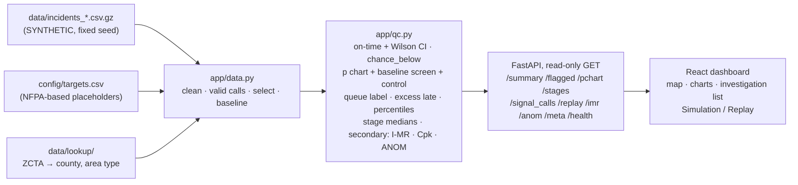

# EMS Response Monitor

**A read-only quality-control dashboard that shows a New York State EMS dispatch center's quality supervisor which
counties and ZIP areas need review, and whether each is below the on-time goal, shows a new statistical change, or both.**

Team **Powerpuff Girls** · Cornell Six Sigma Hackathon 2026, on-campus track ·
Prompt: *Health Systems: Emergency Response*

> **All incident data is SYNTHETIC** (invented calls on real 2020 Census geography), played back as a
> **simulated replay**. It is not live CAD or FDNY data. Requirements: the approved
> [decisions brief](EMS_RESPONSE_MONITOR_DECISIONS.md), with the team's later changes in [SPEC.md](SPEC.md) section 10.
> What works today is in [Build status](#8-build-status). The live URL goes here once deployed.

---

## 1. The problem

Ambulance response times vary widely from place to place, but the dispatch center only looks at **monthly averages**.
An average of 5 minutes "looks fine" even when one urgent call in four in one ZIP area misses the target. The average
hides the late calls, cannot say **where** they happen, and cannot separate a long-running gap from a recent change.

## 2. Who it is for, and the decision it supports

- **User:** the dispatch center's **quality supervisor**. Not the dispatcher assigning an ambulance, not the public.
- **Decision:** which areas need review; for each, two separate questions: **is it meeting the service goal?** and
  **has its process changed from its own history?**
- **What it does not do:** no incident entry or logging forms, no ambulance assignment or ranking of people, no
  what-if or "best fix" (deferred), no stage-by-stage cause analysis or travel-time comparison (removed; plain stage
  medians are shown, descriptive only), no time-of-day analysis, no causal or fairness claims.

## 3. What you see (one page, top to bottom)

| # | Part | Answers | Statistic |
|---|---|---|---|
| – | **Filters** | dataset, urgency (red / yellow / green), date range (default: last 90 days) | none |
| – | **Simulation / Replay** | plays the synthetic file forward one simulated day per tick (3 s); the period start and its baseline stay fixed while the end date advances; the day's calls are listed | read-only feed |
| – | **Summary** | places needing review, split into **recent signal** (Act now + Recent change) and **ongoing gap**, with how many places would read "Below target" **by chance alone** if every place sat exactly at the goal; on-time k of n with 95% CI vs the goal; median and P95 with intervals; calls, cancelled, invalid, cancel %, calls per day | Wilson interval, exact order-statistic intervals, binomial expected count |
| 1 | **Map** state → county → ZIP area, with a back button, and a ranked table | Where? Per place: n, on-time rate + CI, **Target** badge, **Control** badge (with a **watch** chip for one unconfirmed signal), queue label, excess late calls, P95 + CI, volume, baseline stability. Rows rank by label, then by **late calls beyond what the goal allows** | on-time rate, p chart, P95 |
| 2 | **Has the process changed?** | late share by day / week / month against the screened baseline; the evidence for each signal (exact p-value); the **calls behind a signal**; a **stage-median table** (received → assigned → en route → on scene, period vs baseline, % held), descriptive only | p chart with exact binomial signals; baseline screen; dispersion check; optional I chart |
| 3 | **Investigation list** | the flagged places of the current view, plus a **statewide list of flagged ZIP areas** (Act now or Recent change, 30+ valid calls) so a bad ZIP inside a county that looks fine still shows | none new |
| 4 | **Geographic comparison** (secondary) | within one urgency group, which places have typical waits above or below the **call-weighted average** | ANOM on ln(minutes), descriptive only |

The footer states the response-clock caveat (`t_received` meaning is provisional) and that the red targets are
NFPA 1720-based placeholders.

**Two badges, one queue label.** The **Target** badge (Meets / Below / Inconclusive) and the **Control** badge
(In control / Out of control / Insufficient baseline) are always shown. The queue label combines them:

| Target | Control | Queue label |
|---|---|---|
| Below target | Out of control | **Act now: performance gap + recent signal** |
| Below target | In control | **Ongoing gap** |
| Meets target or Inconclusive | Out of control | **Recent process change: investigate** |
| Meets target | In control | **Meets goal; no change signal** |
| anything | Insufficient baseline (or Inconclusive + In control) | **Needs more data / Inconclusive** (confirmed Below-target places sort first) |

"No alert" never means "meets the target", "In control" never means good service, and "Inconclusive" is never shown as a pass.

## 4. How the statistics work

A **valid call** is completed (not cancelled), has `t_onscene`, `valid_time = Y` and times in order; anything else counts
in volume only. Each call's **total wait** is `t_onscene − t_received` (provisional definition, see section 10). A call is
**late** when its total wait is longer than its target in `config/targets.csv`. **Red targets depend on the area type**
(adapted from NFPA 1720 demand zones, illustrative placeholders): urban 8:00, suburban 10:00, rural 14:00, remote 14:00
(NFPA gives no remote value, so rural is reused, flagged). Yellow 15:00 and green 30:00 everywhere; goal 90% on time.
**These are configurable placeholders, not certified standards** (`config/build_targets.py --flat` restores a flat 8:00 red target).

- **Target (specification):** on-time rate with a 95% **Wilson** interval. Meets if the lower bound ≥ goal; Below if the
  upper bound < goal; otherwise Inconclusive, and Inconclusive under 30 valid calls. Beside the count of Below places,
  the page shows **how many would read Below by chance** if every place were exactly at the goal (`qc.chance_below`).
- **Control (p chart):** the **baseline** is the 60 days before the selected range, never overlapping it (120 days if
  under 30 valid calls). Subgroups are days, weeks or months: the shortest with expected late calls n·p̄ ≥ 5 in the
  baseline. **Baseline screen (Phase I):** baseline subgroups whose exact binomial tail is under 0.00135 are dropped once
  and p̄ is recomputed; the baseline is **unstable** (status Insufficient baseline) if another subgroup still stands out,
  more than 10% were dropped, 8 in a row sit on one side of p̄, or the rest are overdispersed (Pearson chi-square,
  α = 0.01). With fewer than 4 baseline subgroups the screen is not run. Limits are p̄ ± 3·√(p̄(1 − p̄)/nᵢ), clipped to [0, 1].
  A subgroup is a **signal** when it is above its UCL **and** its exact binomial p-value P(X ≥ lateᵢ | nᵢ, p̄) is under
  0.00135. **Out of control** needs **2 or more signals, or one with p < 0.00135 / m** (m = subgroups on the chart);
  a single weaker signal stays In control with a **watch** chip.
- **Ranking:** inside a queue label, places rank by **excess late calls** = late − (1 − goal) × valid, so a big place with
  a modest gap outranks a tiny place with a high rate.
- **Percentiles:** median and P95 by linear interpolation, with exact distribution-free 95% intervals from order
  statistics at every n. A bound that needs more calls than there are reads "n/a" (any P95 upper bound needs 59 calls).
- **Secondary, never set a status:** I chart on ln(minutes) (only "beyond 3 sigma" is marked); one-sided Cpk with the
  Bissell bound, whose sigma comes from the moving range across all places and days of the selection, so it is an
  **overall (Ppk-like)** summary, not a within-subgroup capability; ANOM within one urgency group, compared with the
  call-weighted average (a big place pulls the average toward itself; differences can be geography, not service).
  Plain stage medians are descriptive, with no excess or cause attached.

Every statistic is one plain, tested function in `app/qc.py`, checked against a hand-worked known answer and a
degenerate case ([`SPEC.md`](SPEC.md) section 4).



## 5. Inputs

**`incidents.csv`, one row per EMS call.** Ten columns, all of which a dispatch (CAD) system already records. Only six
are needed for the on-time and control statistics; the stage times and `held` feed the descriptive stage table, and
`cancelled` only separates cancelled calls from the rest. **No travel-estimate column is needed** (removed Oct 17, H-14).

| Column | Required | Meaning |
|---|---|---|
| `incident_id` | yes | one call |
| `zcta` | yes | 5-digit ZIP code area where the patient was |
| `urgency_code` | yes | 0 = most urgent to 9 = least (0-2 red, 3-5 yellow, 6-9 green) |
| `t_received`, `t_assigned`, `t_enroute`, `t_onscene` | yes (`t_onscene` empty if cancelled) | ISO 8601 times with the New York offset. `t_received` and `t_onscene` drive the core statistics; the other two give the stage times |
| `cancelled` | yes | Y/N: the call was cancelled (its `t_onscene` is then empty) |
| `valid_time` | yes | Y/N: the times are trustworthy |
| `held` | optional | Y/N: the call waited because no unit was free (shown as % held in the stage table) |

**Messy input never crashes the tool.** Rows with a repeated `incident_id`, an empty or unreadable `t_received`, an
unknown ZIP area or an unknown urgency code are dropped and counted by reason; cancelled, `valid_time = N`, missing-time
and out-of-order calls stay in the call count but never in a time statistic. `/api/health` reports these counts per file.
`data/incidents_messy_sample.csv.gz` (2,901 rows, problems injected) tests this: 36 rows are dropped, exactly the injection log.

**Filters on every request:** `dataset`, `from`, `to`, `urgency`, `level` (state / county / zcta), `id`, `baseline_days`.
No street addresses, coordinates, ambulance IDs or dispatcher IDs are stored. Full API: [`docs/api.md`](docs/api.md).

## 6. Test datasets and demo walkthrough

Three synthetic 12-month files (Oct 16, 2025 to Oct 15, 2026), every New York ZIP area, about 400,000 calls each, built
by a fixed-seed generator from 2020 Census populations at about one-eighth of a typical real call rate, with day-to-day
county effects, winter and summer seasonality, an hour-of-day profile and congestion. Codebook: [`data/README.md`](data/README.md).
All numbers below are red calls, 60-day baseline, measured with the API on the current files.

| Dataset | Planted scenario | Try this | What the tool shows |
|---|---|---|---|
| `baseline` | none (seasonal pattern; rural long trips) | default (Jul 18 to Oct 15), state view | 62 counties: Act now 0, Ongoing gap 19, Recent change 0, Meets goal 16, Needs more data 27. 23 of 60 counties read Below target where chance alone would give about 1.7. 3 counties carry a watch chip. Statewide flagged ZIP list: empty (367 ZIPs checked). The state as a whole reads Recent change (2 daily signals, Aug 6 and Sep 6): a **false alarm** on a file with no planted change; the state's daily chart is the least reliable view (section 7) |
| `station_closure` | from Sep 1, 2026, drive times in ZIP 11368 (Corona, Queens) +60% (set through the generator's travel model) | Queens → ZIP 11368, dates 2026-09-01 to 2026-10-15 | **Act now**: 69.1% on time of 68 calls (95% CI 57.4-78.8%), out of control in both months (exact p = 3.5e-5 for Sep, 5.3e-5 for Oct), 14.2 late calls beyond the goal. The same dates on the clean file: 95.6%, in control, Needs more data |
| `station_closure` | same | default 90 days | 11368 reads **Act now** (85.2% of 183 calls, CI 79.4-89.7%; Sep and Oct above the limit) and is the only entry in the statewide flagged ZIP list; Queens county as a whole reads Meets goal |
| `summer_surge` | Jul-Aug 2026, Monroe County volume +30%, held calls common | Monroe, dates 2026-07-01 to 2026-08-31 | **Act now**: 78.8% of 1,163 calls (CI 76.4-81.1%), 10 weekly signals, 129.7 late calls beyond the goal. Stage medians: received → assigned 86 s vs 42 s in the baseline, held 28.4% vs 2.0%; turnout and drive unchanged. Clean file, same dates: Meets goal, in control. Sep-Oct: Meets goal, in control |
| `summer_surge` | same | default 90 days | Monroe reads Below target but **Needs more data**: its baseline (May 19 to Jul 17) contains the start of the surge, and the baseline screen finds it unstable and refuses to set limits |

**Replay:** choose `station_closure`, click Queens, then ZIP 11368, and press **Start replay**. The period starts Aug 25
and its baseline (Jun 26 to Aug 24) stays fixed while the simulated day advances. 11368 reads *Needs more data* (in
control) through Sep 2; on Sep 3 one small, very surprising month briefly reads Recent change; Sep 4 carries a watch
chip; Sep 5-11 *Needs more data*; Sep 12-18 *Ongoing gap* (watch from Sep 16); **Act now from Sep 19** to the end. On
`summer_surge`, replay starts Jun 25 and Monroe turns **Act now on Jul 4** and stays. A rolling window is not used: its
baseline would drift into the change.

## 7. Measured false alarms and detection power

Reproduce with `PYTHONPATH=. .venv/bin/python data/sensitivity.py` (about 20 s). On the clean `baseline`
file every Out of control is a false alarm:

| Looks (clean file) | Out of control | Notes |
|---|---|---|
| counties, red, three non-overlapping 90-day windows ending Oct 15 | 0 of 186 | 47 of 186 are Insufficient baseline; 4 watch chips |
| counties, yellow, same windows | 1 of 186 (0.5%) | |
| counties, red / yellow, five overlapping 180-day windows | 3 of 310 / 2 of 310 | windows share calls, so this is one rough estimate |
| the state, red, eight overlapping 90-day windows | 1 of 8 (4 evaluable) | daily subgroups; day-to-day effects make the state baseline usually unstable |
| the API test windows (Jul 18-Oct 15, Apr 1-Jun 29, Jan 15-Apr 14), counties, red | 1 of 186 (Oneida, Jan-Apr) | `tests/test_api.py` fails above 10% |

**Detection** (ZIP 11368, red, drive times scaled from Sep 1 in the clean file; status over Sep 1 to Oct 15 and the
first replay day from Aug 25 that is out of control):

| Change | Status Sep 1-Oct 15 | On time | First out-of-control day |
|---|---|---|---|
| none | in control | 95.6% | never |
| ×1.15 | in control | 89.7% | **never (not detected)** |
| ×1.25 | in control | 86.8% | **never (not detected)** |
| ×1.60 (the planted change) | out of control, Act now | 69.1% | Sep 3; stays from Sep 19 |
| drift +2% per week | in control | 92.6% | **never (not detected)** |

**Why the smaller changes are missed:** 11368 has about 68 valid red calls in six weeks at this synthetic volume
(one-eighth of a real system), so its baseline gives monthly subgroups and only two points (Sep, Oct) to judge. A 15-25%
longer drive raises the late share to 10-13%, which two monthly points cannot separate from chance at p < 0.00135, and
the on-time interval still includes 90% (Inconclusive). The tool is tuned to rarely cry wolf; the cost is that it only
sees large changes in a single ZIP. Look at the county, widen the dates, or treat a watch chip as a prompt to keep looking.

## 8. Build status

| Part | Task | Status |
|---|---|---|
| Spec, plan, decisions | H-01, H-11, H-13 | done; open dependencies in SPEC section 10 |
| Test data + codebook + validation | H-02, H-13, H-14 | implemented, tested (`validate.py` 71 PASS; `--reproduce` 75 PASS with identical rebuild; `--messy` 14 PASS) |
| Statistics (`app/qc.py`) | H-03, H-11, H-13 | implemented, tested (known answers + degenerate cases, 86 tests) |
| API (FastAPI, read-only) | H-04, H-11, H-13 | implemented, tested (45 API tests incl. acceptance tests AT-1 to AT-10, 31 data tests) |
| Dashboard | H-05, H-13 | H-13 page changes (watch chip, flagged ZIP list, stage medians, calls behind a signal, split headline) in progress; `demo/README.md` planned |
| Targets config + map shapes | H-09, H-13 | done (red targets tiered by area type, NFPA 1720-based placeholders) |
| Deploy (Posit Connect) | H-06 | planned |
| Fresh-clone check, Devpost | H-08 | planned |
| Real-data compatibility check | – | planned (optional) |
| What-if / intervention ranking | – | **deferred** (removed from the MVP) |

## 9. Run it

```bash
python3 -m venv .venv && .venv/bin/pip install -r app/requirements.txt -r data/requirements.txt
(cd app/frontend && npm ci && npm run build)   # builds the page into app/frontend/dist
bash app/testme.sh                             # http://localhost:8000
```

Verify:

```bash
.venv/bin/python -m pytest tests -q            # 164 passed
(cd app/frontend && npm test)                  # 52 passed
.venv/bin/python data/validate.py --reproduce  # 75 PASS, 0 FAIL
.venv/bin/python data/validate.py --messy      # 14 PASS, 0 FAIL
PYTHONPATH=. .venv/bin/python data/sensitivity.py   # the false-alarm and detection tables of section 7
```

Rebuild the test data (no key needed): `.venv/bin/python data/generate.py`, then `.venv/bin/python config/build_targets.py`.
Only to rebuild the Census lookups: put `CENSUS_API_KEY=...` in a gitignored `.env`, then `python data/build_lookups.py`.

## 10. Limitations and open dependencies

- **Independence is assumed and only partly checked.** The p chart treats calls in a subgroup as independent. The
  synthetic data now has shared day effects per county, so late counts are somewhat overdispersed; the baseline screen
  and dispersion check catch strong cases, but mild overdispersion still narrows the limits a little. Real data may be worse.
- **Seasonality is simulated but not modelled.** Winter roads and summer load are in the data; the tool's defence is the
  60-day baseline just before the period. A baseline that drifts (or contains the start of a change, as Monroe's
  default window shows) is refused by the screen or can mislead; there is no seasonal adjustment.
- **Small samples.** Sparse ZIP areas are often Inconclusive / Insufficient baseline, and only large changes are
  detectable in one ZIP (section 7). P95 upper bounds need 59 calls and read "n/a" below that.
- **Synthetic times are faster than benchmarks** (red median in the clean file: urban 4.65 min, rural 9.08 min, vs roughly 7-10 min
  in published reports); the generator was tuned to land late shares in bands, not to match a real center.
- **Targets are placeholders.** The red tiers borrow NFPA 1720's demand-zone times, but NFPA 1720 is a fire-service
  standard for volunteer departments with a different clock (dispatch or notification to arrival), our area types come
  from Census density, and remote reuses the rural value. A center must set its own.
- **Response-clock start is provisional:** `t_received` could mean the original 911 call or the EMS CAD incident creation.
  It must be confirmed against the source before real use.
- **No causal or fairness claims:** urgency filters do not control for traffic, shift, season, call complexity or
  resources; stage medians and ANOM are descriptive.
- **Where the approved brief was overridden (team decisions, Oct 16):** the brief's acceptance tests AT-6 ("What Held Up
  the Call" with stage excess) and AT-7 (Google travel comparison) and its success phrase "inspect abnormal timing stages"
  are only **partly** met. The stage-excess cause analysis and the travel comparison were removed (H-12); H-13 restored a
  **descriptive** stage-median table (period vs baseline, % held) and the list of calls behind a signal, with no excess,
  ranking or cause.
- **Not in scope:** ambulance assignment, ranking people, route optimization, patient outcomes, what-if optimization,
  incident logging, a live CAD connection, time-of-day filters.

## 11. Sources

- NYC Open Data, [EMS Incident Dispatch Data](https://data.cityofnewyork.us/Public-Safety/EMS-Incident-Dispatch-Data/76xm-jjuj): the column definitions.
- U.S. Census Bureau: 2020 Census DHC populations, ZCTA-to-tract relationship file, and cartographic boundary files.
- NFPA 1720, *Standard for the Organization and Deployment of Fire Suppression Operations, Emergency Medical Operations, and Special Operations to the Public by Volunteer Fire Departments*: demand-zone response times, used only as placeholder tiers.
- Course textbook, [timothyfraser.com/sigma](https://timothyfraser.com/sigma/): SPC and capability.
- Montgomery, *Introduction to Statistical Quality Control*: p chart with varying limits, Phase I baseline, I-MR.
- Wilson, E. B. (1927), "Probable inference...", *JASA* 22: the score interval; Brown, Cai & DasGupta (2001), *Statistical Science* 16: why not the Wald interval.
- Hahn, G. J. & Meeker, W. Q. (1991), *Statistical Intervals*: distribution-free order-statistic intervals for percentiles.
- Bissell, A. F. (1990), "How reliable is your capability index?", *Applied Statistics* 39(3): the Cpk bound.
- Ott (1967) and Nelson (1982): analysis of means.

Hackathon event pages: [schedule](docs/schedule.md) · [criteria](docs/criteria.md) ·
[prompts](docs/prompts.md) · [resources](docs/resources.md) · [agent start](docs/start.md).
