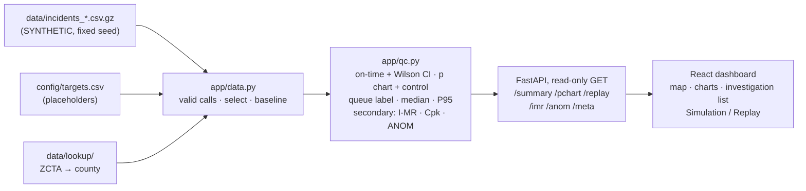

# EMS Response Monitor

**A read-only quality-control dashboard that shows a New York State EMS dispatch center's quality supervisor which
counties and ZIP areas need review, and whether each is below the on-time goal, shows a new statistical change, or both.**

Team **Powerpuff Girls** · Cornell Six Sigma Hackathon 2026, on-campus track ·
Prompt: *Health Systems: Emergency Response*

> **All incident data is SYNTHETIC** (invented calls on real 2020 Census geography), played back as a
> **simulated replay**. It is not live CAD or FDNY data. Requirements: the approved
> [decisions brief](EMS_RESPONSE_MONITOR_DECISIONS.md). What works today is in [Build status](#7-build-status).
> The live URL goes here once deployed.

---

## 1. The problem

Ambulance response times vary widely from place to place, but the dispatch center only looks at **monthly averages**.
An average of 5 minutes "looks fine" even when one urgent call in four in one ZIP area misses the target. The average
hides the late calls, cannot say **where** they happen, and cannot separate a long-running gap from a recent change.

## 2. Who it is for, and the decision it supports

- **User:** the dispatch center's **quality supervisor**. Not the dispatcher assigning an ambulance, not the public.
- **Decision:** which areas need review; for each, two separate questions: **is it meeting the service goal?** and
  **has its process changed from its own history?**
- **What it does not do:** no incident entry or logging forms, no ambulance assignment or ranking of people, no
  what-if or "best fix" (deferred), no stage-by-stage delay breakdown or travel-time comparison (removed), no
  time-of-day analysis, no causal or fairness claims.

## 3. What you see (one page, top to bottom)

| # | Part | Answers | Statistic |
|---|---|---|---|
| – | **Filters** | dataset, urgency (red / yellow / green), date range (default: last 90 days) | none |
| – | **Simulation / Replay** | plays the synthetic file forward one simulated day per tick (3 s); the period start and its baseline stay fixed while the end date advances; the monitor updates and the day's calls are listed | read-only feed |
| – | **Summary** | areas needing review, counts by decision status, on-time k of n with 95% CI vs the goal, median and P95 with intervals | Wilson interval, bootstrap / order-statistic intervals |
| 1 | **Map** state → county → ZIP area, with a back button, and a ranked table | Where? For each area: n, on-time rate + CI, **Target** badge, **Control** badge, queue label, P95 + CI | on-time rate, p chart, P95 |
| 2 | **Has the process changed?** | late share by day / week / month against the baseline; evidence for each signal | p chart with varying limits; dispersion check; optional I chart |
| 3 | **Investigation list** | every flagged area with its target evidence, SPC signal dates, n and baseline window | none new |
| 4 | **Geographic comparison** | ranked typical and slow-call waits, percent over target and sample size, within one urgency | median → P90, configured target, existing Wilson judgment; [data profile and design](app/frontend/docs/geographic-comparison.md) |

**Two badges, one queue label.** The **Target** badge (Meets / Below / Inconclusive) and the **Control** badge
(In control / Out of control / Insufficient baseline) are always shown. The queue label combines them:

| Target | Control | Queue label |
|---|---|---|
| Below target | Out of control | **Act now: performance gap + recent signal** |
| Below target | In control | **Ongoing gap** |
| Meets target or Inconclusive | Out of control | **Recent process change: investigate** |
| Meets target | In control | **Meets goal; statistically stable** |
| anything | Insufficient baseline (or Inconclusive + In control) | **Needs more data / Inconclusive** (confirmed Below-target places sort first) |

"No alert" never means "meets the target", and "Inconclusive" is never shown as a pass.

## 4. How the statistics work

A **valid call** is completed (not cancelled), has `t_onscene`, `valid_time = Y` and times in order; anything else counts
in volume only. Each call's **total wait** is `t_onscene − t_received` (provisional definition, see section 9). A call is
**late** when its total wait is longer than its urgency's target in `config/targets.csv`: red 8:00, yellow 15:00, green
30:00, goal 90% on time. **These targets are configurable placeholders, not certified standards.**

- **Target (specification):** on-time rate with a 95% **Wilson** interval. Meets if the lower bound ≥ goal; Below if the
  upper bound < goal; otherwise Inconclusive, and Inconclusive under 30 valid calls.
- **Control (p chart):** CL = p̄ from the **baseline** (the 60 days before the selected range, never overlapping it;
  120 days if under 30 valid calls). Limits p̄ ± 3·√(p̄(1 − p̄)/nᵢ), clipped to [0, 1], so they widen for small subgroups.
  Subgroups are days, weeks or months: the shortest with n·p̄ ≥ 5 in the baseline. **Out of control** = a subgroup above
  its UCL. A Pearson chi-square check tests whether late counts vary more than binomial.
- **Secondary, never set a status:** I chart on ln(minutes) (only "beyond 3 sigma" is marked), one-sided Cpk with the
  Bissell bound (assumes lognormal times), ANOM within one urgency group (descriptive).

Every statistic is one plain, tested function in `app/qc.py`, checked against a hand-worked known answer and a
degenerate case ([`SPEC.md`](SPEC.md) section 4). **Measured false alarms** of the control rule on the no-change file:
5 of 186 county-windows (2.7%) for red calls over three 90-day windows.



## 5. Inputs

**`incidents.csv`, one row per EMS call.** Nine required columns that dispatch (CAD) systems already record, two optional:

| Column | Required | Meaning |
|---|---|---|
| `incident_id` | yes | one call |
| `zcta` | yes | 5-digit ZIP code area where the patient was |
| `urgency_code` | yes | 0 = most urgent to 9 = least (0-2 red, 3-5 yellow, 6-9 green) |
| `t_received`, `t_assigned`, `t_enroute`, `t_onscene` | yes (`t_onscene` empty if cancelled) | ISO 8601 times with the New York offset |
| `disposition` | yes | TRANSPORTED / TREATED / REFUSED / CANCELLED |
| `valid_time` | yes | Y/N: the times are trustworthy |
| `eta_google_s` | optional | travel estimate at assignment, seconds (**generated** in these files; checked by `validate.py` but not used by the dashboard) |
| `held` | optional | Y/N: the call waited because no unit was free |

**Filters on every request:** `dataset`, `from`, `to`, `urgency`, `level` (state / county / zcta), `id`, `baseline_days`.
No street addresses, coordinates, ambulance IDs or dispatcher IDs are stored. Full API: [`docs/api.md`](docs/api.md).

## 6. Test datasets and demo walkthrough

Three synthetic 12-month files (Oct 16, 2025 to Oct 15, 2026), every New York ZIP area, about 400,000 calls each, built
by a fixed-seed generator from 2020 Census populations at about one-eighth of a typical real call rate. Codebook:
[`data/README.md`](data/README.md).

| Dataset | Planted scenario | Try this (red calls) | What the tool shows |
|---|---|---|---|
| `baseline` | seasonal pattern only; rural long trips | default (last 90 days) | 51 of 62 counties need review, mostly **Ongoing gap** (rural counties below the 8-minute target, in control); 3 counties out of control (false alarms, counted) |
| `station_closure` | from Sep 1, 2026, travel estimates **and actual drives** in ZIP 11368 (Corona, Queens) +60% | Queens → ZIP 11368, dates 2026-09-01 to 2026-10-15 | **Act now**: 73.5% on time (95% CI 62.0-82.6%), out of control in the months of Sep and Oct. With the default 90 days it reads **Needs more data** (too few late calls in its May-Jul baseline) |
| `summer_surge` | Jul-Aug 2026, Monroe County volume +30%, held calls common | Monroe, dates 2026-07-01 to 2026-08-31 | **Act now**, 8 weekly signals. Sep-Oct: back in control |

**Replay:** choose `station_closure`, click Queens, then ZIP 11368, and press **Start replay**. The period starts Aug 25, and its
baseline (Jun 26 to Aug 24) stays fixed while the simulated day advances: 11368 reads *Needs more data* (in control)
through Sep 10 and turns **Act now** by Sep 20, once September's late calls accumulate. On `summer_surge`, replay starts
Jun 25 and Monroe turns **Act now** within July. A rolling window is not used: its baseline would drift into the change.

## 7. Build status

| Part | Task | Status |
|---|---|---|
| Spec, plan, decisions | H-01, H-11 | done; open dependencies listed in SPEC section 10 |
| Test data + codebook + validation | H-02 | implemented, tested (`validate.py`: 55 PASS, identical rebuild from seed) |
| Statistics (`app/qc.py`) | H-03, H-11 | implemented, tested (known answers + degenerate cases) |
| API (FastAPI, read-only) | H-04, H-11 | implemented, tested (acceptance tests AT-1 to AT-10) |
| Dashboard | H-05, H-11 | implemented, render-tested, checked in a browser on live data; `demo/README.md` planned |
| Targets config + map shapes | H-09 | done (targets now flat placeholders) |
| Deploy (Posit Connect) | H-06 | planned |
| Fresh-clone check, Devpost | H-08 | planned |
| Real-data compatibility check | – | planned (optional) |
| What-if / intervention ranking | – | **deferred** (removed from the MVP) |

## 8. Run it

```bash
python3 -m venv .venv && .venv/bin/pip install -r app/requirements.txt -r data/requirements.txt
(cd app/frontend && npm ci && npm run build)   # builds the page into app/frontend/dist
bash app/testme.sh                             # http://localhost:8000
```

Verify:

```bash
.venv/bin/python -m pytest tests -q            # 122 passed
(cd app/frontend && npm test)                  # 26 passed
.venv/bin/python data/validate.py --reproduce  # 55 PASS, 0 FAIL
```

Rebuild the test data (no key needed): `.venv/bin/python data/generate.py`, then `.venv/bin/python config/build_targets.py`.
Only to rebuild the Census lookups: put `CENSUS_API_KEY=...` in a gitignored `.env`, then `python data/build_lookups.py`.

## 9. Limitations and open dependencies

- **Response-time start is provisional:** `t_received` could mean the original 911 call or the EMS CAD incident creation.
  It must be confirmed against the source before real use.
- **Targets are placeholders** until a center or authority sets them.
- **Sparse ZIP areas** are often Inconclusive / Insufficient baseline; widen the dates or look at the county.
- **No causal or fairness claims:** urgency filters do not control for traffic,
  shift, season, call complexity or resources. Seasonality and case-mix changes are not modelled beyond the dispersion check.
- **Not in scope:** ambulance assignment, ranking people, route optimization, patient outcomes, what-if optimization,
  incident logging, a live CAD connection, time-of-day filters, and (removed Oct 16 as too much for this version) the
  "What Held Up the Call" stage breakdown and the ambulance-vs-Google travel comparison.

## 10. Sources

- NYC Open Data, [EMS Incident Dispatch Data](https://data.cityofnewyork.us/Public-Safety/EMS-Incident-Dispatch-Data/76xm-jjuj): the column definitions.
- U.S. Census Bureau: 2020 Census DHC populations, ZCTA-to-tract relationship file, and cartographic boundary files.
- Course textbook, [timothyfraser.com/sigma](https://timothyfraser.com/sigma/): SPC and capability.
- Montgomery, *Introduction to Statistical Quality Control*: p chart with varying limits, I-MR.
- Wilson, E. B. (1927), "Probable inference...", *JASA* 22: the score interval; Brown, Cai & DasGupta (2001), *Statistical Science* 16: why not the Wald interval.
- Bissell, A. F. (1990), "How reliable is your capability index?", *Applied Statistics* 39(3): the Cpk bound.

Hackathon event pages: [schedule](docs/schedule.md) · [criteria](docs/criteria.md) ·
[prompts](docs/prompts.md) · [resources](docs/resources.md) · [agent start](docs/start.md).
