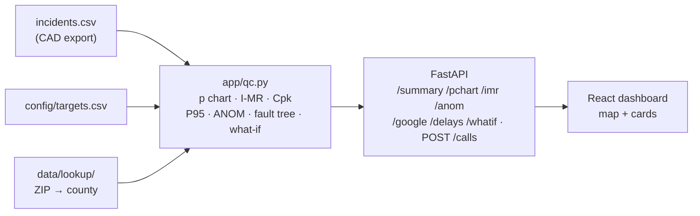

# EMS Response Monitor

**A quality-control dashboard that shows a 911 / EMS dispatch center's quality supervisor which New York
counties and ZIP codes have ambulances arriving late, whether it is a real change, why, and which fix
would help most.**

Team **Powerpuff Girls** · Cornell Six Sigma Hackathon 2026, on-campus track ·
Prompt: *Health Systems: Emergency Response*

> **Status (Oct 16, 2026, evening):** the design, spec and plan are written, and the test data is being
> generated. The statistics, API and dashboard are not built yet. The [Build status](#7-build-status)
> table says what works today. The live URL goes here once deployed.

---

## 1. The problem

Ambulance response times vary widely from place to place, but the 911 center only looks at **monthly
averages**. An average of 6.9 minutes "looks fine" even when 1 urgent patient in 4 waits more than 8
minutes in one ZIP code. The average hides the dangerous calls in the right tail, and it can't say
**where** the late calls happen or **why**.

## 2. Who it is for, and the decision it supports

- **User:** the dispatch center's **quality supervisor**. Not dispatchers mid-call, and not the public.
- **Decision, each day:** which places need attention, whether a delay is a **real recent change** or a
  **long-running gap**, which step of the response costs the minutes (911 center, crew or drive), and
  which fix to fund (post an ambulance closer, add an ambulance, or speed up the 911 center or the crew).

## 3. What you see (top to bottom, one page)

| # | Card | Answers | Statistic |
|---|---|---|---|
| 1 | **Map**, New York State → county → ZIP code, with a back arrow | Where are the late calls? | % late, P95, status flag |
| 2 | **Summary card** | How many places need attention; median wait; P95 | counts, percentiles with bootstrap interval |
| 3 | **Map coloring and flags** | Act now / Recent change / Ongoing gap / On track / Not enough calls | one-sided Cpk bound + control-chart signals |
| 4 | **Urgency and date filters** | Red / yellow / green calls, any date range | none new |
| 5 | **ANOM**: consistently slower than the rest? | Which places are slower or faster than average, beyond chance | analysis of means on ln(minutes), ANOVA F |
| 6 | **p chart**: a real change or bad days? | Did the share of late calls jump above its normal range? | p chart with varying limits, run test |
| 7 | **I-MR chart**: every urgent call | Which single calls were far outside normal? | I-MR on ln(minutes), 8 Nelson tests |
| 8 | **Ambulance vs Google** | Did trips get longer, or did driving get slower? | medians, histogram of drive − Google estimate |
| 9 | **What held up each late call** | 911 center, crew, long trip, slow drive or no ambulance free? | fault tree (series OR), excess over baseline median |
| 10 | **Which fix helps most** | % late and P95 if one step were faster | replay of the selected calls with one step changed |

**How to read a flag:** a flagged place is slower than its own recent history (the 60 days before the
range) explains. The cards below it name the step to look at first.

## 4. How the statistics work

Each call's **total wait** is `t_onscene − t_received`. A call is **late** when the total wait is longer
than its urgency's target in `config/targets.csv`, for example 8:00 for red calls. The limits come from
the **baseline**: the 60 days before the selected range, stretched to 120 days if there are fewer than
30 calls.

- **p chart:** CL = p̄ from the baseline. Limits = p̄ ± 3·√(p̄(1 − p̄)/nᵢ), with the LCL floored at 0.
  Subgroups are days, or weeks where the place averaged under 10 calls a day.
- **I-MR on ln(minutes):** σ̂ = M̄R̄ / 1.128. I limits = CL ± 3σ̂, MR UCL = 3.267·M̄R̄. Tests 1, 2 and 5
  raise alerts.
- **Cpk (one-sided) on ln(minutes):** (ln USL − x̄)/(3σ̂). Its 95% upper bound (Bissell) is
  Cpk + 1.645·√(1/(9n) + Cpk²/(2(n − 1))). "Too slow overall" means the bound is below z(goal)/3, which
  is 0.427 for a 90% on-time goal.
- **P95** with a 2,000-resample bootstrap 95% interval.
- **ANOM:** limits = x̄ ± h·σ̂ₚ·√((N − nᵢ)/(N·nᵢ)), with h = z(1 − 0.05/(2k)).

| Status | Too slow overall? | Changed recently? |
|---|---|---|
| Act now | yes | yes |
| Recent change | no | yes |
| Ongoing gap | yes | no |
| On track | no | no |
| Not enough calls | under 30 calls in the selection | — |

Every statistic is one plain, tested function in `app/qc.py`, checked against a hand-worked known
answer and a degenerate case. The numbers are in [`SPEC.md`](SPEC.md) section 4 and
[`docs/plan.md`](docs/plan.md).



## 5. Inputs: only what a dispatch center already logs

**`incidents.csv`, one row per 911 EMS call.** Nine required columns that dispatch (CAD) systems
already record, plus two optional ones:

| Column | Required | Meaning |
|---|---|---|
| `incident_id` | yes | one call |
| `zcta` | yes | 5-digit ZIP code area where the patient was |
| `urgency_code` | yes | the center's code, 0 = most urgent to 9 = least |
| `t_received`, `t_assigned`, `t_enroute`, `t_onscene` | yes (`t_onscene` empty if cancelled) | ISO 8601 times with the New York offset |
| `disposition` | yes | TRANSPORTED / TREATED / REFUSED / CANCELLED |
| `valid_time` | yes | Y/N: the times are trustworthy |
| `eta_google_s` | optional | Google's drive estimate with traffic at assignment, in seconds (unlocks card 8) |
| `held` | optional | Y/N: the call waited because no ambulance was free |

**`config/targets.csv`** holds each urgency code's group, target and on-time goal. These are
placeholders until a center sets its own: red (0–2) 8:00, yellow (3–5) 15:00, green (6–9) 30:00,
each with a 90% goal.

**Filters on every request:** `from`, `to`, `urgency`, `level` (state / county / zcta), `id`,
`baseline_days`.

No street addresses, coordinates, ambulance IDs or dispatcher IDs are stored. That protects patient
privacy and keeps the tool from blaming individuals.

## 6. Test datasets

There are three synthetic 12-month files (Oct 16, 2025 to Oct 15, 2026), each covering every New York
ZIP area with about 400,000 calls. A fixed-seed generator builds them from 2020 Census populations, at
about 2% of a realistic call rate. Each file plants one story with a known answer:

| File | Planted story | The tool should show |
|---|---|---|
| `data/incidents_baseline.csv.gz` | yearly pattern only (summer peak) | rural ZIPs = Ongoing gap from long trips; no recent-change flags |
| `data/incidents_station_closure.csv.gz` | from Sep 1, 2026, Google estimates in ZIP 11368 (Corona, Queens) rise 60% | that ZIP turns Act now in early September; "post an ambulance closer" helps most |
| `data/incidents_summer_surge.csv.gz` | Jul–Aug 2026, Monroe County volume +30%, ambulances often busy | flagged in July and August only; "add an ambulance" helps most |

The codebook is [`data/README.md`](data/README.md). It covers every file and column, the real-world
source of each field, and how the files are rebuilt.

## 7. Build status

| Part | Task | Status |
|---|---|---|
| Spec, plan | H-01 | written; the Devpost prompt number is still to add |
| Test data + codebook | H-02 | in progress |
| Statistics (`app/qc.py`) + tests | H-03 | not started |
| API (FastAPI) | H-04 | not started |
| Dashboard + demo walkthrough | H-05 | not started |
| Deploy (Posit Connect) | H-06 | not started |
| Targets config + map shapes | H-09 | targets done; shapes not started |

## 8. Run it

*Coming with H-04.* The goal is one command from a fresh clone (`bash app/testme.sh`). To rebuild the
test data:

```bash
python3 -m venv .venv && source .venv/bin/activate
pip install -r data/requirements.txt
python data/generate.py        # rebuilds the three .csv.gz files from data/lookup/ (no key needed)
python data/validate.py        # prints PASS/FAIL for every data check
# Only to rebuild the Census lookups: add CENSUS_API_KEY=... to a .env file (never commit it), then
python data/build_lookups.py
```

## 9. Not in scope

Route optimization, ranking individual ambulances or dispatchers, shift (time-of-day) filters, patient
outcomes, and a live CAD connection. `POST /calls` and replay mode stand in for real-time logging.

## 10. Sources

- NYC Open Data, [EMS Incident Dispatch Data](https://data.cityofnewyork.us/Public-Safety/EMS-Incident-Dispatch-Data/76xm-jjuj): the column definitions.
- U.S. Census Bureau: 2020 Census DHC populations, ZCTA-to-tract relationship file, and cartographic boundary files.
- Course textbook, [timothyfraser.com/sigma](https://timothyfraser.com/sigma/): SPC, capability, and fault trees.
- Bissell, A. F. (1990), "How reliable is your capability index?", *Applied Statistics* 39(3): the Cpk confidence bound.

Hackathon event pages: [schedule](docs/schedule.md) · [criteria](docs/criteria.md) ·
[prompts](docs/prompts.md) · [resources](docs/resources.md) · [agent start](docs/start.md).
