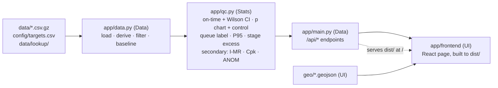

# Roles: who owns what (3 people)

Each role owns its files and its CONTRACT tasks. Write only inside your own paths; if you need a file another
role owns, ask them. The seams between roles are fixed in [`docs/api.md`](api.md): the `app/qc.py` function
signatures (Stats ↔ Data) and the JSON each endpoint returns (Data ↔ UI). Change a seam only together.

| Role | Owns (files) | CONTRACT tasks | Done means |
|---|---|---|---|
| **1. UI**: the page people see | `app/frontend/`, `geo/`, `demo/` | H-05 (page + demo walkthrough), H-09 (map shapes) | the 5 sections (decisions brief) render from the live API for all 3 datasets; `demo/README.md` walks each one |
| **2. Stats**: the numbers are right | `app/qc.py`, `tests/test_qc.py` | H-03 (every statistic, tested), runs the stats review before any check-in | `pytest tests/test_qc.py` passes every known answer and degenerate case in SPEC §4; stats-reviewer PASS table |
| **3. Data in the website**: data → API → live URL | `app/main.py`, `app/data.py`, `app/requirements.txt`, `app/*.sh`, `app/README.md`, `tests/test_data.py`, `tests/test_api.py`, `docs/api.md`, `data/`, `.github/`, `.gitignore`, `README.md` | H-04 (API), H-06 (deploy), H-07 (README, with a section from each role), H-08 (public repo, Devpost) | `bash app/testme.sh` serves the API and the built page on one URL; deployed on Posit Connect |

## How the pieces fit

## Working rules for all three

1. **One CONTRACT task at a time per person.** Check it out (`status: in_progress`, your name as owner) and check it in (`status: done` + a one-line result) in the same commit as the work.
2. **Pull before you start, and commit small.** Stage explicit paths only (`git add app/qc.py tests/test_qc.py`), never `git add .`.
3. **Build in order:** Stats first (numbers before any styling). UI builds against the fixtures in `app/frontend/src/fixtures/` until the API answers, then switches to the API.
4. **Never put a key in a file.** `.env` is gitignored; the Census key is only needed to rebuild `data/lookup/`.
5. **Before trusting any number on the page,** Stats runs the stats-reviewer on it.

## Hand-offs, in time order

| When | From → To | What |
|---|---|---|
| first | Stats → Data | `app/qc.py` functions with the signatures in `docs/api.md` (tests passing) |
| first | Data → UI | `/api/*` live on `localhost:8000`, JSON shaped as in `docs/api.md` |
| by midnight | Data | a first deploy to Posit Connect (bare API is enough) |
| by 6 AM | UI → all | the page renders all 3 datasets; the cut line in `docs/plan.md` applies after this |
| by 11 AM | all | README sections, `demo/README.md`, fresh-clone test, Devpost entry (due 1 PM) |
